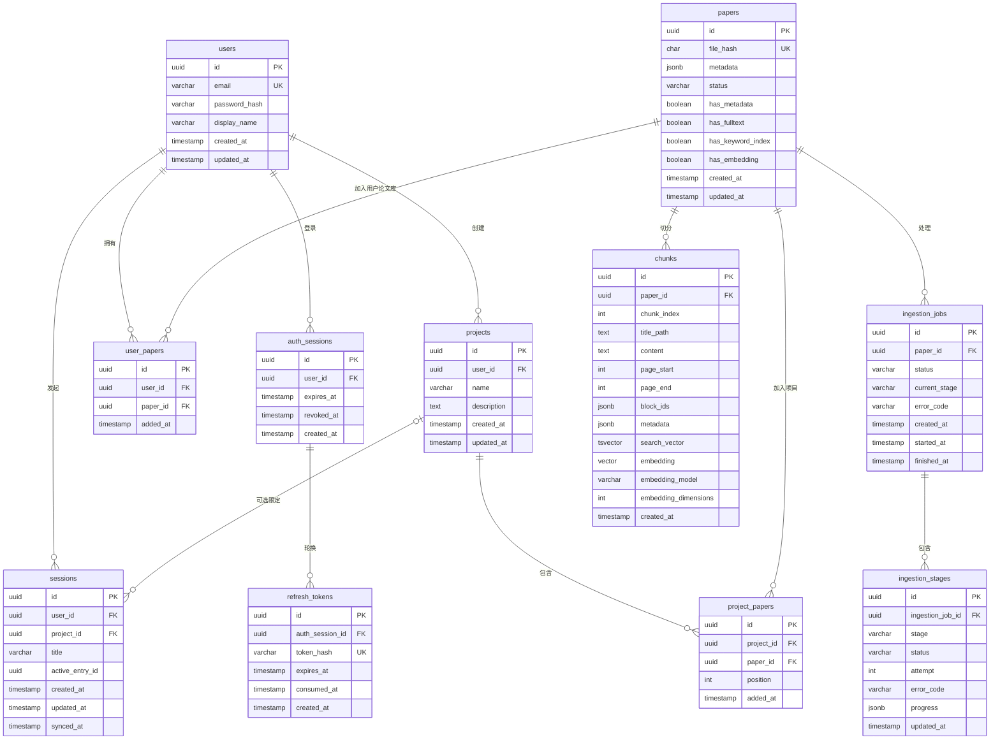

# Paper Agent — 论文智能阅读后端原型

> 状态：MVP 目标设计。当前仓库仍处于 FastAPI 模块化单体骨架阶段，本文描述的是待实现的产品与架构契约，不代表相关服务、表或 API 已经落地。

## 1. 项目定位

Paper Agent 是一个面向个人研究者的**多用户论文阅读后端**。每位用户拥有相互隔离的个人论文库，可以把论文逐步加入项目，并在个人全库或项目范围内通过 Agent 检索、阅读和问答。

首版核心闭环：

1. 用户注册并登录。
2. 上传英文 born-digital 学术 PDF。
3. 查看可理解的解析进度与阶段能力。
4. 在个人全库或项目范围内与 Agent 对话。
5. 回答中的关键事实可以定位到论文原文。

### 1.1 交付形态

- 本仓库只交付 REST/SSE 后端 API，不包含正式网页前端。
- 后续网页前端通过 API 使用服务；当前使用 OpenAPI 与 Yaak 请求集合进行联调和验收。
- 首版正式支持单机 Docker Compose，不承诺多实例水平扩展。
- 这是简历项目，但状态机、权限隔离、RAG、故障语义和测试应按完整工程实现。

### 1.2 首版非目标

- 不支持团队空间、组织或共享会话。
- 不支持中文论文、扫描件 OCR、损坏或加密 PDF。
- 不提供从个人论文库移除论文、从项目移除论文的功能。
- 不提供独立搜索页面，但提供 Agent 使用的检索工具和可测试的检索 API。
- 不做 rerank；首版使用关键词与向量的混合召回。
- 不做解析任务取消、分块/Embedding 重建或多索引版本切换。
- 不做专门的文档提示注入识别或清洗；首版 Agent 仅拥有只读文献工具，以限制影响面。
- 联网搜论文、相似论文、笔记/标注、预定义或自定义 Agent、定时 workflow、引文网络和结构化阅读产物均后置。

MVP 后最优先考虑联网论文搜索，但首版只稳定 Tool、Entry/Event、Artifact 和 Citation 的扩展边界，不预先设计通用工作流 DSL。

---

## 2. 核心领域语义

### 2.1 论文与用户论文

- **Paper** 是按 PDF SHA-256 全局去重的论文实体，同一文件在系统中只保存一份 PDF、解析产物和检索索引。
- **User Paper** 是用户与 Paper 的关系实体。只有存在 `user_papers` 关系，用户才能发现、读取或检索该论文。
- 全局去重是内部实现，不得通过响应字段、资源身份或错误信息暴露其他用户是否上传过同一文件。
- 首版只新增 `user_papers`，不提供主动移除。未来可在该关系上增加收藏、阅读状态和最近阅读时间；追加式阅读行为另建事件表。

### 2.2 项目

- Project 是用户论文库的受限子集，通过 `project_papers` 关联表维护。
- 用户只能把自己论文库中的 Paper 添加到 Project。
- 首版项目论文集合只增不减，避免已有会话引用失去可见性。
- 删除 Project 时，级联终止并删除项目下全部 Sessions、Entry JSONL、Redis 状态和 `project_papers`；Paper 与 `user_papers` 不受影响。

### 2.3 会话与 Entry

- Session 是 Agent 对话的持久边界，归属于一个用户，可选归属于一个 Project。
- `project_id IS NULL` 表示个人全库会话，默认可见该用户全部 User Papers。
- `project_id IS NOT NULL` 表示项目会话，Project Papers 是文献工具不可突破的硬边界。
- `project_id` 创建后不可修改；需要不同范围时新建 Session。
- Session 不保存独立的 Agent Run 或 Message 表。消息、工具调用、压缩、模型切换、usage 和引用统一表示为追加式 Entry，并保存为 JSONL。
- 正在进行的 Agent 生成只是 Session 的临时执行状态，不是长期领域资源。

### 2.4 引用

- Citation 是 Agent 最终回答对检索证据的稳定引用。
- 模型只能选择本次检索证据集中存在的 Citation ID；后端验证其存在性、用户权限和检索范围。
- Citation 至少包含 Paper、Chunk、页码范围和原文片段；展示格式与模型输出解耦。

---

## 3. 技术栈

| 组件 | 选型 | 职责 |
|---|---|---|
| Python | 3.13 | 与当前仓库版本一致 |
| 后端 | FastAPI | REST API、认证、SSE、同步业务入口 |
| ORM / 迁移 | SQLAlchemy 2.0 + Alembic + psycopg | 同步数据库访问和版本化迁移 |
| 数据库 | PostgreSQL 16 + pgvector | 业务数据、英文全文检索、向量检索 |
| 队列 | Celery + Redis | 论文解析、Embedding、清理等后台任务 |
| Redis | Redis + AOF | Celery Broker、锁、热 Entry、pending 队列、短期 SSE 事件 |
| 对象存储 | S3 兼容服务（自建 RustFS / 云对象存储） | PDF、MinerU 原始产物、Session JSONL |
| 元数据 | GROBID | 提取标题、作者、摘要、期刊、DOI 等 |
| 全文解析 | MinerU API | 生成 `content_list.json`、Markdown 和图片 |
| Embedding | 实例级远程 API | 固定模型生成 Chunk 向量 |
| Agent | AgentScope | Agent loop、模型适配、工具调用与上下文压缩 |
| 日志 | structlog + stdlib logging | JSON/开发态日志与请求关联 |

FastAPI 业务链路沿用当前同步 SQLAlchemy Session。Agent 流式执行使用异步 I/O，但不因此把整套 ORM 改为异步。

---

## 4. 数据模型

### 4.1 ER 图



### 4.2 约束

- `user_papers`：`UNIQUE(user_id, paper_id)`。
- `project_papers`：`UNIQUE(project_id, paper_id)`；Project 与 User Paper 必须属于同一用户。
- `sessions.user_id` 必填，`project_id` 可空；非空时 Project 必须属于同一用户。
- `auth_sessions` 表示一个登录设备的 token family；每次轮换都新增一条 `refresh_tokens`，旧记录保留 consumed 状态以检测复用。
- `chunks`：`UNIQUE(paper_id, chunk_index)`。
- `chunks.embedding` 在 Embedding 阶段完成前可空；只有 `has_embedding = true` 的 Paper 可以进入向量检索。
- 所有时间使用带时区 UTC 时间。
- API 不接受调用者传入 `user_id` 决定数据归属；所有权来自认证身份。

### 4.3 字段归属

- 全局解析事实保存在 `papers.metadata`，同时记录来源与解析器版本。
- 用户修正、标签和阅读状态未来放在 User Paper 一侧，不修改全局 Paper。
- MinerU、Embedding 和 LLM Key 不存入 `users` 或普通 JSONB 偏好字段。
- 文件路径不落数据库，通过 `file_hash` 和固定对象路径规则定位。

---

## 5. 认证与用户配置

### 5.1 注册与登录

首版支持注册、登录、刷新、登出；不做邮箱验证、找回密码和管理员角色。

- 密码使用 Argon2id 等适合密码的哈希算法。
- Access token 是有效期 15 分钟的 JWT，浏览器只保存在运行时内存。
- Refresh token 是有效期 7 天的高熵随机值，通过 `HttpOnly + Secure` Cookie 保存；数据库只保存哈希。
- 页面硬刷新后调用 `/v1/auth/refresh` 获取新的 Access token。
- Refresh token 每次使用都在事务中轮换；并发使用只能有一次成功。
- 已轮换 token 再次出现时撤销该登录会话的 token family。
- 登出撤销当前 token family；已有 Access token 最多继续有效到 15 分钟过期。

独立浏览器前端调用刷新和登出接口时使用 credentialed request。生产 CORS 只允许显式 Origin，并正确设置 Cookie 的 SameSite 策略；Refresh/Logout 端点还要校验 Origin，避免跨站请求利用 Cookie。

### 5.2 Provider 配置

- MinerU 与 Embedding 的 URL、Key、模型为实例级环境变量，由部署者固定。
- LLM Provider 与模型从 AgentScope Model Card 目录选择，用户只填写 API Key；公共 API 不接受任意 `base_url`。
- LLM Key 不进入 PostgreSQL、Redis、MinIO、日志、Entry 或幂等响应缓存。
- README 明确说明数据流向：PDF 发往 MinerU、Chunk 文本发往 Embedding 服务、用户问题与检索证据发往 LLM。首版不提供用户级出站开关或额外披露 UI。

---

## 6. 上传、去重与解析状态机

### 6.1 上传契约

上传接口流式接收 PDF，并在请求路径同步完成：

- 文件大小限制；
- PDF magic 与基础可读性检查；
- SHA-256 计算；
- 临时对象提交。

校验成功后返回 `202 Accepted` 与 `ingestion_job_id`，解析全程在 Celery 后台执行。文件名、MIME 和解析器输出路径都视为不可信输入。

首版只承诺英文 born-digital 学术 PDF。扫描、加密、损坏或超过配置上限的文件返回稳定错误码。

### 6.2 全局去重

- `papers.file_hash` 全局唯一。
- 相同文件并发上传时，同一 Paper/固定配置只启动一个 Ingestion Job；其他用户关联并订阅同一处理结果。
- 后到请求不得获知是否由其他用户先上传，只返回自身可见的 User Paper/Job 表述。
- 上传校验并确定全局 Paper 后，立即幂等创建 `user_papers` 和可选的 `project_papers`，使用户可以查看处理中或部分可用状态；解析结果直接复用全局 Chunks，不复制数据。

Redis 锁 Key 使用 `ingestion_lock:{file_hash}`。锁包含随机 owner token，通过原子脚本续租和释放；任务本身仍必须幂等，不能只依赖锁保证正确性。

### 6.3 处理阶段

| 阶段 | 输入 | 输出 | 执行位置 |
|---|---|---|---|
| metadata | PDF | GROBID 元数据 | Celery worker 调用 GROBID |
| fulltext | PDF | MinerU `content_list.json`、Markdown、图片 | Celery worker 调用远程 API |
| chunking | `content_list.json` | Chunk 记录与英文检索文本 | Celery worker 本地逻辑 |
| embedding | Chunk content | pgvector 向量 | Celery worker 调用远程 API |

每次处理由 Ingestion Job 表示，状态为 `queued/running/succeeded/failed`。每个阶段独立记录状态、attempt、进度和稳定错误码。

### 6.4 部分可用与重试

- 阶段成功产物立即持久化，不伪装成单个数据库事务。
- Paper 生命周期状态与能力分离：`has_metadata`、`has_fulltext`、`has_keyword_index`、`has_embedding`。
- 上游成功、Embedding 失败时，元数据和全文仍可读取；只有具备相应能力的接口可以调用。
- 网络超时、429、供应商 5xx 采用有界指数退避。
- 鉴权失败、额度不足和输入非法不自动重试。
- 重试从最近可验证的阶段产物继续，每个阶段必须幂等。
- 首版不支持用户取消、换模型重建或多版本索引并存。

---

## 7. 内容、分块与索引

### 7.1 内容契约

- MinIO 保存 MinerU 原始 `content_list.json`、Markdown 和图片。
- 首版业务直接使用 `content_list.json` 原始结构，不另建内部 DocumentBlock schema。
- 必须记录 MinerU 版本并校验所需字段；不兼容结构以明确错误失败，不能静默误解析。

### 7.2 分块

- 采用类似 RAGFlow `naive_merge` 的合并式切分，按原子块顺序累积。
- 分块 tokenizer 与固定 Embedding 模型绑定，并设置供应商硬字符上限。
- 标题路径、正文、摘要和图表说明进入索引；表格保留结构化文本；参考文献单独标型并降低关键词权重；公式和脚注按 MinerU 原始类型处理。
- 超过 Embedding 模型上限的原子块必须二次切分，并保存子范围，不能直接提交超限或丢弃。
- Chunk 可跨页，保存 `page_start/page_end`、`block_ids`、原文片段和可用的坐标信息。
- 坐标在离线处理阶段提取，在线引用接口不扫描整份大 JSON。

### 7.3 Embedding

- Embedding URL、Key、模型与维度由实例固定。
- Chunk 记录模型和维度，启动及迁移时校验数据库向量维度与配置一致。
- 首版只有一套活动索引；更换模型需要离线迁移，不提供用户级重建功能。

---

## 8. 混合检索与 RAG

### 8.1 检索范围

检索必须先做用户授权，再应用范围：

- `paper`：用户论文库中的指定 Paper；
- `project`：指定 Project 当前的全部 Project Papers；
- `library`：当前用户全部 User Papers。

全库 Session 固定使用 library 范围；项目 Session 固定使用 project 范围。项目会话中的 Agent 不可越界到个人全库，但用户可以通过普通 API 向项目追加论文。

### 8.2 混合召回

首版不宣称 BM25，也不做 rerank：

1. PostgreSQL `tsvector/tsquery + GIN` 对英文文本进行关键词召回。
2. pgvector 使用固定距离度量进行向量相似度召回。
3. 两路各取 Top-N，合并并按 Chunk 去重。
4. 使用 RRF（Reciprocal Rank Fusion）融合排名，不直接相加不可比的原始分数。
5. 合并相邻证据，并限制每篇论文进入最终证据集的数量。
6. 应用证据数量和分数下限；证据不足时明确返回无充分证据状态。

检索参数作为实例配置，并通过固定英文评测集确定默认值。

### 8.3 回答与引用

- Agent 只能从系统给出的证据集中选择 Citation ID。
- 后端验证 Citation 属于当前用户和 Session 范围。
- 回答显式区分论文陈述、跨论文综合与模型推断。
- 证据不足时说明论文中没有足够相关内容，不用通用知识填充。
- 论文内容不做专门提示注入检测或清洗；文献工具保持只读，不能修改项目或执行外部副作用。

---

## 9. Agent、Session 与 Entry 日志

### 9.1 Entry 模型

Session JSONL 是追加式 Entry 日志。首行是 Session Header，后续每行一个 Entry。通用字段：

```json
{
  "type": "message",
  "id": "entry_uuid",
  "parent_id": "previous_entry_uuid",
  "sequence": 42,
  "timestamp": "2026-08-26T00:00:00Z",
  "schema_version": 1,
  "payload": {}
}
```

首版 Entry 类型至少覆盖：

- user / assistant / tool-result message；
- model change；
- thinking-level change；
- context compaction；
- branch summary；
- citation / usage 等扩展信息。

上下文沿当前 leaf 的 `parent_id` 路径重建。最近一次 Compaction Entry 用摘要替换旧前缀，并从 `first_kept_entry_id` 保留尾部。AgentScope 负责执行和压缩，Paper Agent 适配层把框架事件转换为 Entry；框架内部 `reply_id` 不成为公共领域概念。

### 9.2 Agent 工具

首版是受限 RAG Agent，工具集固定且只读：

- `list_papers`：列举 Session 范围内论文；
- `search_papers`：在 Session 范围内混合检索；
- `get_paper_excerpt`：按 Citation/Chunk 取原文与定位。

所有工具在执行时重新校验用户和范围，不能因为历史 Entry 含有某个 Paper ID 就绕过授权。Agent loop 和工具调用总次数设有上限。

### 9.3 临时执行与 pending

HTTP 层无状态，但活动 LLM 调用由当前 FastAPI 进程中的 Session Executor 执行。每个 Session 同时只有一个 Executor，Redis 租约锁负责协调。

Redis 为每个 Session 保存两个 FIFO pending 队列：

- `steering`：当前 assistant turn 及工具批次结束后的安全边界注入；
- `follow_up`：Agent 原本准备停止且没有 steering 时注入。

两种队列默认 `one-at-a-time`。pending 消息排队时不是 Entry；实际投递时才原子地移出队列并写成 user Entry。Redis AOF 保护尚未投递的 pending。

用户主动停止或 Executor 中断时：

- 保留已生成的 assistant message；
- 写入 `stop_reason = aborted`；
- 后续上下文仍包含该 Entry；
- 已完成工具结果立即持久化，未完成工具调用必须补一个 aborted/error Tool Result，避免孤儿 Tool Call。

进程重启后活动生成不能续跑，写为 aborted；pending 仍保留，客户端用已保存的模型选择与 Key 触发恢复。

### 9.4 Entry 存储

| 层 | 结构 | 作用 |
|---|---|---|
| Redis | `session:{user_id}:{session_id}:entries` List | 活跃 Session 的热 Entry 日志 |
| Redis | 两个 pending FIFO | steering / follow-up 恢复 |
| Redis | 短期 Event Stream | SSE 断线重放 |
| MinIO | 单 Session JSONL 对象 | 冷持久历史与导出 |
| PostgreSQL | `sessions` | 所有权、Project、标题、活动 leaf、同步游标 |

- 用户消息成功追加到 Redis 后即视为已确认，并立即启动/通知 Executor。
- Redis 开启 AOF，`appendfsync everysec`；接受极端主机故障时约一秒尾部数据风险。
- 每次追加重置空闲计时；默认空闲 5 分钟后，在单 Session 刷回锁内把完整 Entry 日志写入 MinIO。
- MinIO 对象写入成功后更新 `synced_at` 和最大 sequence；恢复时按 sequence 校验和合并 Redis 热尾部。
- 不依赖关闭页面、切换页面等前端事件触发持久化，页面离开后 Agent 可继续生成。

### 9.5 Session 操作

- 支持创建、列表、读取、改名、删除和导出。
- 支持基于旧 Entry 创建分支，不允许原地编辑历史 Entry。
- 删除活动 Session 时，先进入 deleting 状态、终止生成并清空 pending，再通过幂等清理任务删除 PostgreSQL、Redis 和 MinIO 数据。
- 删除 Project 使用相同流程级联清理其全部 Sessions；跨 PostgreSQL/Redis/MinIO 的删除不伪装成单一事务。

---

## 10. API 与事件契约

### 10.1 资源组织

所有公共 API 使用 `/v1` 前缀，主要资源为：

```text
/v1/auth/*
/v1/papers/*
/v1/projects/*
/v1/sessions/*
/v1/search
```

Agent 对话不提供长期 `/runs` 资源。建议的 Session API：

```text
POST   /v1/sessions
GET    /v1/sessions
GET    /v1/sessions/{session_id}
PATCH  /v1/sessions/{session_id}
DELETE /v1/sessions/{session_id}
GET    /v1/sessions/{session_id}/entries
GET    /v1/sessions/{session_id}/events
POST   /v1/sessions/{session_id}/messages
POST   /v1/sessions/{session_id}/stop
GET    /v1/sessions/{session_id}/export
```

`POST .../messages` 接收 `delivery = steering | follow_up`；Session 空闲时消息立即成为下一条输入。启动或恢复 Executor 时使用部署端模型配置。

### 10.2 SSE

SSE 绑定 Session。Redis 短期 Event Stream 保存递增事件 ID，客户端通过 `Last-Event-ID` 或等价游标重连；只承诺客户端短暂断线续流，不承诺后端进程重启后恢复未完成生成。

由于业务 API 使用 Bearer Access token，浏览器前端通过 `fetch` 读取 SSE stream，而不依赖无法设置 Authorization Header 的原生 `EventSource`。

统一事件信封：

```json
{
  "event_id": "...",
  "type": "message.delta",
  "resource_id": "session_uuid",
  "sequence": 42,
  "timestamp": "...",
  "schema_version": 1,
  "data": {}
}
```

事件类型至少包括 `generation.started`、`message.delta`、`thinking.delta`、`trace.message`、`tool.started`、`tool.completed`、`queue.updated`、`generation.completed`、`generation.aborted` 和 `generation.failed`。`trace.message` 表示工具调用前已经形成的一条 Assistant 中间消息；它作为结构化 Trace Entry 保存，不归类为 Thinking 或最终回答。

### 10.3 错误

HTTP 状态码表示错误大类，响应使用最小统一结构：

```json
{
  "code": "paper_not_found",
  "message": "论文不存在",
  "request_id": "..."
}
```

- `code` 使用稳定的 `snake_case` 字符串。
- `details` 仅在参数校验等确有需要时返回。
- 供应商原始错误只进入脱敏日志。

### 10.4 幂等、并发与限速

- 上传和消息提交支持 `Idempotency-Key`，网络重试返回同一业务结果。
- 更新使用版本字段或 ETag 防止丢失更新。
- 后台任务与阶段写入本身必须幂等。
- 用户/session 级速率限制处理短时间高频 prompt，超限返回 `429` 和 `Retry-After`。
- 不按 prompt 文本永久去重，因为用户可能有意重复提问。

---

## 11. 文件与 Redis Key 规范

### 11.1 对象存储

> 选型更新（2026-09）：MinIO 社区版已归档（只保留源码、不再维护），故不再选用。
> 当前实现是 `ObjectStorage` 抽象 + 两种实现：`local`（默认，单机挂卷）与 `s3`
> （任何 S3 兼容服务；本地开发/试用用 RustFS，部署可换 Garage 或云对象存储）。
> 下面的 Key 布局与实现一致，换后端只改配置。

```text
papers/{h0h1}/{h2h3}/{file_hash}.pdf

mineru/{h0h1}/{h2h3}/{file_hash}/
  content_list.json
  full.md
  images/...

sessions/{user_id}/{session_id}.jsonl
```

对象存储 Bucket 不公开；客户端通过鉴权后的后端接口或短期预签名 URL 访问允许的对象。

### 11.2 Redis

```text
ingestion_lock:{file_hash}
session:{user_id}:{session_id}:entries
session:{user_id}:{session_id}:pending:steering
session:{user_id}:{session_id}:pending:followup
session:{user_id}:{session_id}:events
session:{user_id}:{session_id}:executor_lock
```

UUID 不构成授权。任何 Redis/MinIO Key 的构造都必须先通过 PostgreSQL 所有权校验。

---

## 12. 架构与任务边界

```text
Browser / Yaak
       │ REST + SSE
       ▼
FastAPI modular monolith
  ├─ auth
  ├─ library / projects
  ├─ ingestion API
  ├─ retrieval
  └─ session Agent executor
       │
       ├──────── PostgreSQL + pgvector
       ├──────── Redis + AOF
       ├──────── MinIO
       └──────── AgentScope + user LLM provider

Celery workers
  ├─ GROBID metadata
  ├─ MinerU full text
  ├─ chunking / FTS
  ├─ embedding
  └─ temporary-object cleanup
```

- Agent 生成留在 FastAPI 进程，不经过 Celery；模型配置由部署端注入。
- Celery 只处理使用实例级凭据、可幂等重试的后台工作。
- 领域模块沿用仓库现有的 domain/application/api/persistence 垂直切片，platform 只放数据库、日志、对象存储、队列等横切设施。

---

## 13. 安全与可观测性

### 13.1 安全基线

- 所有数据访问按认证用户过滤；Paper 的全局 ID 和文件哈希不能绕过 `user_papers`。
- TLS 保护浏览器、后端和外部 Provider 之间的传输。
- PostgreSQL、Redis、MinIO 和 GROBID 不直接暴露公网。
- PDF 上传设置大小、页数、超时、内存与并发限制；临时路径和解析器输出不可信。
- LLM Provider 使用允许列表，禁止用户控制任意服务器出站 URL。
- 不记录密码、Cookie、JWT、LLM Key、论文全文、完整 Prompt 或大块工具结果。
- 网关负责公网入口限流；应用层仍实现按用户/session 的消息限速。

### 13.2 日志与指标

日志使用 `request_id`、`session_id`、`paper_id`、`ingestion_job_id` 串联，不使用并不存在的 Agent Run ID。

首版至少观测：

- HTTP 状态、时延和稳定错误码；
- Celery 队列长度和各解析阶段时延/成功率；
- MinerU、Embedding、LLM 供应商错误分类；
- Agent token usage、生成完成/中断/失败；
- Redis、PostgreSQL、MinIO 容量与健康状态。

### 13.3 备份恢复

- PostgreSQL 与 MinIO 做自动备份并保留恢复说明。
- Redis 通过 AOF 保护热 Entry 和 pending，但不是长期备份替代品。
- 至少执行一次从 PostgreSQL + MinIO 备份恢复的演练。
- 目标基线：每日备份，RPO 24 小时、RTO 4 小时；具体周期可通过部署配置收紧。

---

## 14. 配置基线

| 配置 | 说明 |
|---|---|
| `DATABASE_URL` | PostgreSQL + psycopg 连接串 |
| `REDIS_URL` | Redis/Celery 连接串 |
| `MINIO_ENDPOINT` / `MINIO_BUCKET` | MinIO 地址与 Bucket |
| `MINIO_ACCESS_KEY` / `MINIO_SECRET_KEY` | MinIO 凭据 |
| `GROBID_URL` | GROBID 服务地址 |
| `MINERU_API_URL` / `MINERU_API_KEY` | 实例级 MinerU 配置 |
| `EMBEDDING_API_URL` / `EMBEDDING_API_KEY` | 实例级 Embedding 配置 |
| `EMBEDDING_MODEL` / `EMBEDDING_DIMENSIONS` | 固定索引模型与维度 |
| `LLM_PROVIDERS` | 对用户开放的 AgentScope 原生 Provider 目录 |
| `JWT_SECRET_KEY` | Access token 签名密钥 |
| `ACCESS_TOKEN_TTL_MINUTES` | 默认 15 |
| `REFRESH_TOKEN_TTL_DAYS` | 默认 7 |
| `CORS_ORIGINS` | 显式允许的网页 Origin |
| `MAX_PDF_BYTES` / `MAX_PDF_PAGES` | 上传资源上限 |
| `CHUNK_TOKEN_NUM` | 目标 Chunk token 数，默认 512 |
| `KEYWORD_TOP_N` / `VECTOR_TOP_N` / `RRF_K` | 混合检索参数 |
| `SESSION_IDLE_FLUSH_SECONDS` | Redis Entry 刷回 MinIO 的空闲时间，默认 300 |
| `LOG_LEVEL` / `LOG_JSON` | 日志级别与输出格式 |

所有秘密必须显式配置且无生产默认值；文档和示例配置只能使用明显的占位符。

---

## 15. MVP 验收

### 15.1 端到端场景

1. 两个用户注册登录，彼此无法列出或检索对方论文。
2. 两人上传同一 PDF，系统只解析一次，但各自获得独立 User Paper 且不知道对方存在。
3. 用户创建 Project、添加论文并创建项目 Session；Agent 只能查询项目论文。
4. 用户创建无 Project 的 Session；Agent 可以查询个人全库。
5. Agent 回答包含可验证 Citation，证据不足时明确拒绝硬答。
6. 关键词与向量通道各自召回，RRF 生成稳定混合排序。
7. SSE 断线后从最近事件继续；后端进程重启则活动回答标记 aborted，pending 可由用户触发继续。
8. steering 与 follow-up 按各自 FIFO 和 pi 风格安全边界消费。
9. 删除活动 Session 或 Project 时，生成、pending、Redis 与 MinIO 数据均按约定清理。

### 15.2 测试层级

- 单元测试：状态机、阶段幂等、分块边界、上下文投影、RRF、Citation 校验。
- 集成测试：PostgreSQL/pgvector、Redis AOF 语义、MinIO 刷回恢复、Celery 重试、全局去重锁。
- API 契约测试：认证轮换、所有权、错误码、Idempotency-Key、限速、SSE 重放。
- RAG 固定样例：英文论文关键词/语义查询、跨论文配额、无证据场景、引用定位。
- Yaak 集合：覆盖完整 MVP 闭环，作为人工联调和简历演示入口。

---

## 16. 已知限制与演进方向

- 直接依赖 MinerU `content_list.json`；通过固定版本和结构校验控制变化风险，未来可引入内部 DocumentBlock schema。
- 中文解析与关键词检索后置。
- rerank 后置；评测证明 RRF 不足时再选择远程 API 或本地模型服务。
- 论文/项目论文移除后置；届时重新设计历史 Citation、孤儿对象和用户行为保留语义。
- Agent 生成只支持单机进程级连续性，后端重启不能恢复活动 LLM 调用。
- LLM Key 保存在用户浏览器，只随 Agent 启动或恢复请求进入后端执行器，不写入业务存储。
- 未实现专门的文档提示注入防护，不适合作为拥有外部副作用工具的开放 Agent 平台。
- MVP 后优先扩展联网论文搜索；网络工具必须另行设计出站策略、权限和审计。
